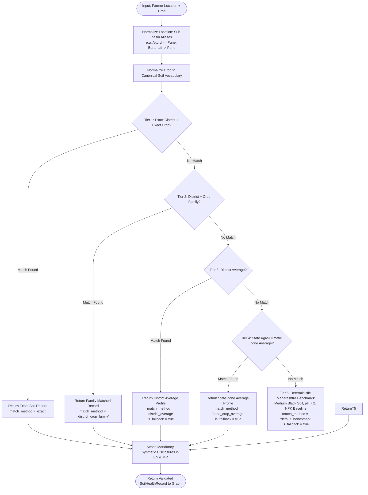
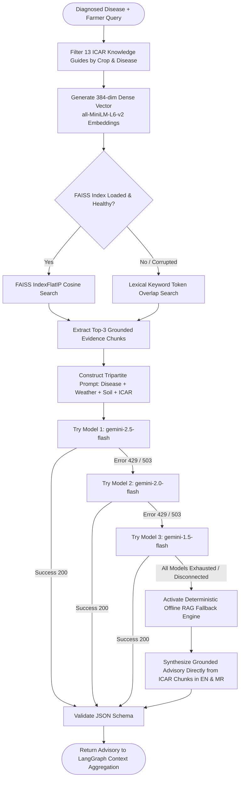
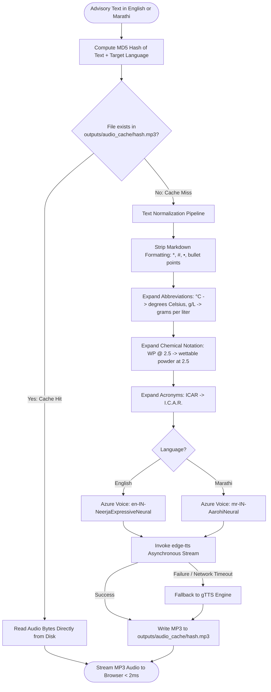

# 📊 AI Agriculture Assistant — System Flowcharts

This document provides visual flowcharts covering the end-to-end execution pipeline, LangGraph StateGraph DAG, decision gates, parallel context subsystems, and offline fallback mechanisms.

---

## 1. Master LangGraph StateGraph Workflow Flowchart

```mermaid
flowchart TD
    Start([Farmer Accesses Application]) --> InputChoice{Choose Mode}

    %% Branch A: Leaf Diagnosis
    InputChoice -->|Mode 1: Leaf Diagnosis /analyze| Upload[Upload Leaf Image <= 10MB + City + Question]
    
    %% Branch B: Direct Q&A
    InputChoice -->|Mode 2: Ask Agronomist /ask| DirectQ[Enter Farming Question + Optional Crop/Disease + City]

    %% Mode Routing in LangGraph
    Upload --> QualityNode["quality_node (Quality Inspection Gate)"]
    DirectQ --> SetupAsk["setup_ask_context (Extract Intent & Normalize Crop)"]

    %% Quality Check Gate
    QualityNode --> QCheck{Image Quality Check Passed?<br/>Blur >= 35.0, 30 <= Brightness <= 230, Dim >= 100px}
    
    QCheck -->|No: Low Res / Blurry / Glare| EarlyExit["Early Termination -> END<br/>Return Quality Remediations (No Model/LLM Spent)"]
    
    %% Valid Image Processing
    QCheck -->|Yes: Valid Leaf Photo| PredictionNode["prediction_node (MobileNetV3-Large)<br/>Top-3 Predictions & Softmax Confidence"]

    %% Parallel Context Fan-Out
    PredictionNode --> FanOut
    SetupAsk --> FanOut

    subgraph ParallelServices ["Parallel Context Ingestion Layer (Concurrent Async Tasks)"]
        FanOut --> WeatherNode["weather_node<br/>Live OpenWeatherMap & Open-Meteo<br/>Epidemiological Fungal/Bacterial Risk"]
        FanOut --> SoilNode["soil_node<br/>100-Record Synthetic Maharashtra Soil Dataset<br/>5-Tier Fallback Hierarchy"]
        FanOut --> RAGNode["rag_node<br/>FAISS Dense Vector Cosine Search (62 Chunks)<br/>Automatic Lexical Keyword Overlap Fallback"]
        FanOut -.->|If Grad-CAM Enabled| GradCAMNode["gradcam_node<br/>features.16.0 Conv Layer Hook<br/>Visual Saliency Heatmap Overlay"]
    end

    WeatherNode --> Barrier["context_aggregation_node<br/>(Deterministic Synchronized Join Barrier)"]
    SoilNode --> Barrier
    RAGNode --> Barrier
    GradCAMNode -.-> Barrier

    %% Generative Advisory with Fallback
    subgraph ReasoningLayer ["Advisory Synthesis & Fallback Cascade"]
        Barrier --> GeminiNode["gemini_guidance_node<br/>(Single LLM Invocation Budget)"]
        GeminiNode --> CallGemini{Call Google GenAI SDK}
        
        CallGemini -->|HTTP 200: Success| LLMResponse[Primary: gemini-2.5-flash]
        
        CallGemini -->|HTTP 429 Rate Limit / 503| RetryCandidate{Try Candidate Chain}
        RetryCandidate -->|Model Available| FallbackModels[gemini-2.0-flash / gemini-1.5-flash]
        RetryCandidate -->|All Cloud Quotas Exhausted| OfflineEngine[Deterministic Offline RAG Template Engine<br/>Synthesizes Exact ICAR Evidence into Structured JSON]
    end

    LLMResponse --> SchemaValidation[Enforce Strict JSON Schema & State Output]
    FallbackModels --> SchemaValidation
    OfflineEngine --> SchemaValidation

    %% Output Presentation Layer
    subgraph OutputLayer ["Farmer Output & Accessibility"]
        SchemaValidation --> StateAdapter[state_to_api_response() -> JSON]
        StateAdapter --> DisplayUI[Render UI: Disease Badge, Meter, Heatmap, Grounded Advisory]
        
        DisplayUI --> TTSCheck{Farmer Clicks Audio Listen?}
        TTSCheck -->|Yes| AudioCache{Audio Cached on Disk?<br/>outputs/audio_cache/MD5.mp3}
        
        AudioCache -->|Cache Hit| FastAudio[Load Audio < 2ms]
        AudioCache -->|Cache Miss| AzureTTS[Azure Neural TTS: edge-tts<br/>mr-IN-AarohiNeural / en-IN-Neerja<br/>gTTS Backup Engine]
        AzureTTS --> SaveCache[Save MP3 to Disk Cache]
        SaveCache --> FastAudio
        
        FastAudio --> PlayAudio([Play High-Fidelity Audio to Farmer])
        TTSCheck -->|No| Done([Session Ready for Follow-Up Question])
    end
```

---

## 2. 5-Tier Soil Health Hierarchical Matching Flowchart



---

## 3. Image Quality Gate Decision Flowchart

```mermaid
flowchart TD
    ImgIn([Input Leaf Photo]) --> BoundedRead{Bounded Stream Read<br/>content <= 10MB?}
    BoundedRead -->|Exceeds 10MB| Err413[Return HTTP 413: Payload Too Large]
    BoundedRead -->|Empty (0 bytes)| Err400[Return HTTP 400: Empty File]
    
    BoundedRead -->|Valid Size| Decode[Decode Image Bytes to RGB]
    
    Decode --> SizeGate{Width >= 100 px<br/>AND<br/>Height >= 100 px?}
    SizeGate -->|No| ErrSize[Return quality error: low_resolution]
    
    SizeGate -->|Yes| AspectGate{Aspect Ratio <= 3.0?}
    AspectGate -->|No| ErrAspect[Return quality error: extreme_aspect_ratio]
    
    AspectGate -->|Yes| Gray[Convert to Grayscale Luma]
    Gray --> BrightCalc[Calculate Mean Pixel Brightness: μ]
    
    BrightCalc --> DarkGate{μ < 30.0?}
    DarkGate -->|Yes| ErrDark[Return quality error: too_dark / underexposed]
    
    DarkGate -->|No| BrightGate{μ > 230.0?}
    BrightGate -->|Yes| ErrBright[Return quality error: too_bright / flash glare]
    
    BrightGate -->|No| BlurCalc[Convolve with 3x3 Laplacian Kernel<br/>Calculate Variance: Var∇²I via SciPy]
    
    BlurCalc --> BlurGate{Var >= 35.0?}
    BlurGate -->|No| ErrBlur[Return quality error: excessive_blur]
    
    BlurGate -->|Yes| Pass([Quality Check Passed: Proceed to MobileNetV3])
```

---

## 4. RAG & Gemini Multi-Model Cascade Flowchart



---

## 5. Text-to-Speech (TTS) Normalization & Caching Flowchart



---

## 6. ASCII System Flowchart (For Project Reports & PPT Slides)

```text
================================================================================================
                       AI AGRICULTURE ASSISTANT (KRISHI SAHAYYAK) FLOWCHART
================================================================================================

  [ Farmer Uploads Leaf Image <= 10MB ]       [ Farmer Enters Direct Question ]
                 │                                           │
                 ▼                                           │
   ┌───────────────────────────┐                             │
   │    quality_node           │                             │
   │ • Laplacian Blur (Var>=35)│──[Fail: Blurry/Dark/Glare]─► [ Early Exit -> END ]
   │ • Brightness (30 to 230)  │                             │ (No Model/LLM Compute Spent)
   │ • Dimensions (>=100px)    │                             │
   └─────────────┬─────────────┘                             │
                 │ (Pass)                                    ▼
                 ▼                             ┌───────────────────────────┐
   ┌───────────────────────────┐               │    setup_ask_context      │
   │     prediction_node       │               │ • Intent Classification   │
   │ • MobileNetV3-Large CNN   │               │ • Crop Synonym Mapping    │
   │ • Top-3 Classes + Softmax │               └─────────────┬─────────────┘
   └─────────────┬─────────────┘                             │
                 │                                           │
                 ▼                                           ▼
   ┌───────────────────────────────────────────────────────────────────────┐
   │             Asynchronous Parallel Context Ingestion Branches          │
   │ • weather_node : Live OpenWeatherMap / Open-Meteo Fallback + Risk     │
   │ • soil_node    : 100-Record Synthetic Maharashtra Soil Dataset (5-Tier)│
   │ • rag_node     : FAISS Dense Cosine Search + Lexical Keyword Fallback │
   │ • gradcam_node : Layer features.16.0 Attention Heatmap Overlay        │
   └───────────────────────────────────┬───────────────────────────────────┘
                                       │
                                       ▼
   ┌───────────────────────────────────────────────────────────────────────┐
   │        context_aggregation_node (Synchronized Join Barrier)           │
   │ • Awaits All Context Tasks (Deterministic Barrier Ordering)           │
   │ • Formats Tripartite Context (Disease + Microclimate + Soil)          │
   └───────────────────────────────────┬───────────────────────────────────┘
                                       │
                                       ▼
   ┌───────────────────────────────────────────────────────────────────────┐
   │      gemini_guidance_node (Strict Single Cloud Call Budget)           │
   │ • Candidate Cascade: gemini-2.5-flash -> 2.0-flash -> 1.5-flash       │
   │ • Deterministic Offline RAG Fallback: Synthesizes ICAR Chunks         │
   │ • Outputs Bilingual Structured Advisory in English and Marathi        │
   └───────────────────────────────────┬───────────────────────────────────┘
                                       │
                                       ▼
   ┌───────────────────────────────────────────────────────────────────────┐
   │                       Farmer Results Interface                        │
   │ • Primary Foliar Diagnosis with Confidence Meter                      │
   │ • Visual Grad-CAM Lesion Saliency Heatmap                             │
   │ • Agro-Climatic Soil Chemistry & Live Epidemiological Weather Card    │
   │ • Grounded Agronomist Advisory & Prevention Measures (EN/MR)          │
   │ • Sub-2ms Neural Voice Audio Playback (Edge-TTS Azure Engine)         │
   └───────────────────────────────────────────────────────────────────────┘
```
