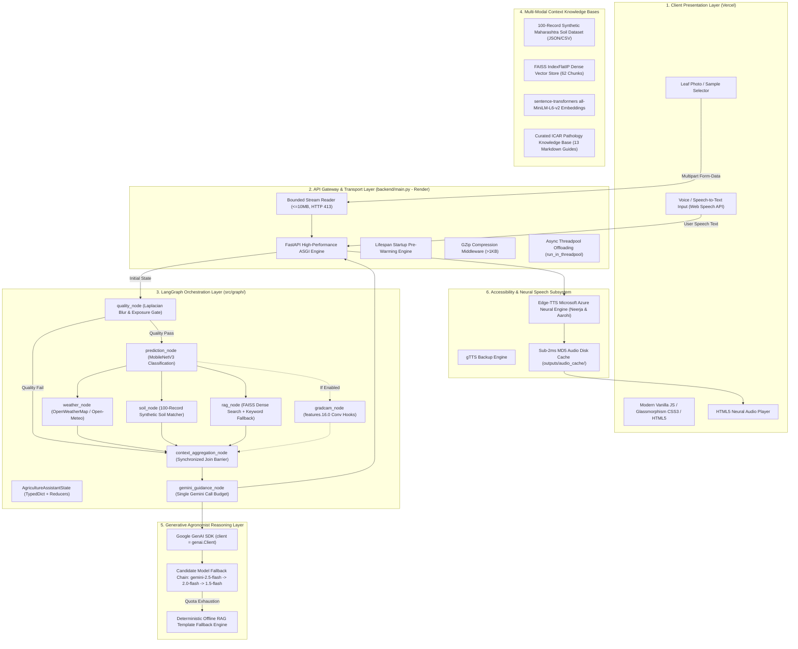
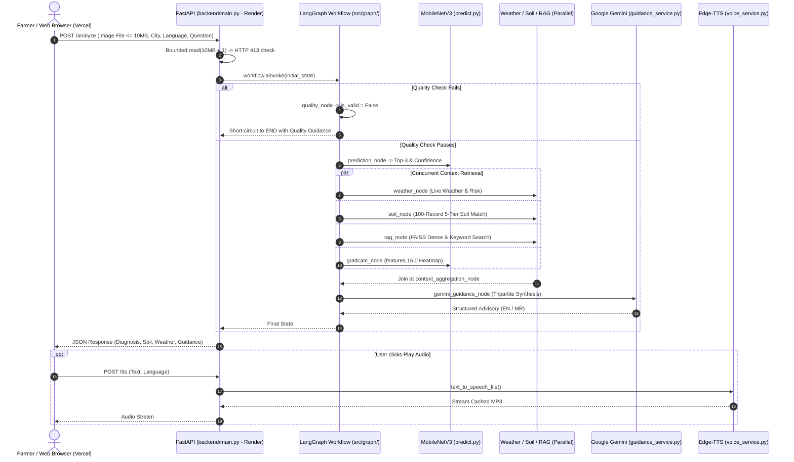

# 🏛️ AI Agriculture Assistant (कृषी सहाय्यक) — System Architecture Specification

**Project Level:** Final Year / Mini Project Engineering Research  
**Domain:** Multimodal Deep Learning, LangGraph State Orchestration, Retrieval-Augmented Generation (RAG), Generative AI & Agri-Tech  
**Status:** Production-Ready & Deployed  
**Document Version:** 3.0.0  
**Live Production Deployments:**  
- **Frontend (Vercel):** [https://krishi-sahayyak.vercel.app](https://krishi-sahayyak.vercel.app)  
- **Backend (Render):** [https://krishi-sahayyak.onrender.com](https://krishi-sahayyak.onrender.com)  

---

## 1. Executive Architectural Overview

The **AI Agriculture Assistant** is an academically grounded, high-performance decision-support platform designed to solve a critical bottleneck in smallholder Indian agriculture: **the gap between rapid foliar disease detection and actionable, safe, regional-language agronomist advisory.**

### The Core Architectural Problem
1. **Perception vs. Reasoning Decoupling:** Standalone computer vision models (CNNs) can classify leaf lesions but cannot reason about microclimate risks, explain pathological symptoms, or answer farmer questions.
2. **LLM Hallucination Risk:** Generic Large Language Models (LLMs) hallucinate chemical fungicide dosages, confuse crop varieties, and give dangerous or non-compliant spray advice when prompted directly with images.
3. **Environmental Invariance:** Laboratory ML models fail in real-world fields where high humidity accelerates fungal spore germination and rain triggers bacterial splash infection.
4. **Soil Interdependence:** Soil pH, volumetric moisture, and macronutrient balances directly govern crop vigor and susceptibility, yet traditional tools omit soil context.
5. **Linguistic & Rural Accessibility:** Rural Indian farmers require guidance in native regional languages (Marathi / English) delivered via voice rather than complex text.

### Architectural Solution
The system employs an **Asynchronous LangGraph-Orchestrated Multimodal Pipeline**:
* **Perception:** A fine-tuned **MobileNetV3-Large** convolutional neural network with **Grad-CAM** visual saliency explainability.
* **Orchestration:** A stateful, asynchronous **LangGraph StateGraph** managing conditional routing, parallel context fan-out, and synchronization barriers.
* **Domain Grounding:** A **FAISS Vector Store** indexed with verified **ICAR (Indian Council of Agricultural Research)** pathology publications and lexical keyword fallback.
* **Microclimate Awareness:** Live meteorological telemetry from **OpenWeatherMap** with automatic zero-key fallback to **Open-Meteo**.
* **Regional Soil Health:** An **Agro-Climatic Soil Health Service** with 100 validated synthetic records and a 5-tier hierarchical matching algorithm.
* **Generative Reasoning:** **Google Gemini** via the official `google-genai` SDK with multi-model cascading and an offline RAG template fallback engine.
* **Voice Delivery:** **Microsoft Azure Neural TTS** (via `edge-tts`) with authentic Indian conversational voices (`mr-IN-AarohiNeural` / `en-IN-NeerjaExpressiveNeural`) and `gTTS` fallback.

---

## 2. High-Level System Architecture Diagram



---

## 3. LangGraph Orchestration & State Architecture

### 3.1 State Schema (`AgricultureAssistantState`)
State is declared as a Python `TypedDict` in `src/graph/state.py` with explicit `operator.add` reducers to guarantee thread-safe parallel branch execution:

```python
class AgricultureAssistantState(TypedDict, total=False):
    # Request inputs
    request_type: str                  # "analyze" or "ask"
    user_question: str
    language: str                      # "english" or "marathi"
    location: str
    image_input: bytes | str | None
    include_gradcam: bool

    # Quality Gate
    image_is_valid: bool
    quality_reasons: list[str]
    quality_metrics: dict[str, Any]

    # Vision & Perception
    predicted_crop: str | None
    predicted_disease: str | None
    prediction_confidence: float
    is_low_confidence: bool
    top_predictions: list[dict[str, Any]]
    gradcam_base64: str | None

    # Context Branch Outputs
    weather_data: dict[str, Any]
    soil_data: dict[str, Any]
    retrieved_evidence: list[dict[str, Any]]
    evidence_sources: list[str]

    # Generative Guidance
    final_guidance: dict[str, Any]

    # Reducer-protected execution tracking
    completed_stages: Annotated[list[str], operator.add]
    error_information: Annotated[list[str], operator.add]
```

### 3.2 Key Graph Design Principles
1. **Parallel Context Fan-Out:** `weather_node`, `soil_node`, `rag_node`, and optional `gradcam_node` execute concurrently via asyncio tasks.
2. **Deterministic Join Barrier:** `context_aggregation_node` collects results from all context branches, evaluates fallbacks for any failed branch, and produces an aggregated payload for Gemini.
3. **Single LLM Call Budget:** Gemini is called exactly once per successful request in `gemini_guidance_node`, eliminating runaway API billing and latency.
4. **Early Termination on Quality Failure:** If leaf quality checks fail, the workflow bypasses perception, context retrieval, and LLM calls, returning quality remediation advice in $< 15\text{ ms}$.

---

## 4. Subsystems Deep-Dive

### Subsystem 1: Computer Vision & Saliency (`src/prediction/predict.py`)
- **Model Architecture:** MobileNetV3-Large (`models/mobilenetv3_best.pth`, 17.08 MB) fine-tuned on 13 Solanaceae classes across Bell Pepper, Potato, and Tomato.
- **Top-3 Probability Calibration:** Computes Softmax class probabilities and highlights alternative potential diagnoses if confidence is below 60%.
- **Grad-CAM Hooks:** Intercepts activations and gradients at `features.16.0` (final point-wise convolution) using defensive forward/backward hooks removed in a `finally` block to prevent GPU/CPU memory leaks.

### Subsystem 2: Soil Health Service (`src/soil/soil_service.py`)
- **Validated Dataset:** 100 verified synthetic records (`data/soil/synthetic_soil_records.json` and `.csv`) covering Maharashtra districts.
- **5-Tier Fallback Matching Hierarchy:**
  1. *Tier 1:* Exact District + Exact Crop (`match_method="exact"`).
  2. *Tier 2:* District + Similar Crop family (`match_method="district_crop_family"`).
  3. *Tier 3:* District-level average across all crops (`match_method="district_average"`).
  4. *Tier 4:* State-level agro-climatic zone average (`match_method="state_crop_average"`).
  5. *Tier 5:* Deterministic Maharashtra benchmark (`match_method="default_benchmark"`).
- **Mandatory Disclosures:** Every response explicitly carries `data_type="synthetic"`.

### Subsystem 3: RAG Knowledge Base (`src/rag/vector_store.py`)
- **Knowledge Documents:** 13 markdown files in `knowledge_base/` covering ICAR and TNAU management guides for all 13 supported classes.
- **Dense Vector Search:** 62 extracted chunks indexed in FAISS (`models/rag_index.faiss`) using `all-MiniLM-L6-v2` dense embeddings.
- **Keyword Fallback:** Automatic lexical token-overlap retrieval if FAISS or sentence-transformers is uninitialized.

### Subsystem 4: Live Weather Service (`src/weather/weather_service.py`)
- **Dual Providers:** OpenWeatherMap primary with automatic zero-key fallback to Open-Meteo.
- **Microclimate Risk Heuristics:** Computes epidemiological risk scores for Late Blight, Early Blight, Bacterial Spot, and Spider Mites.

### Subsystem 5: Gemini Generative Advisory (`src/gemini/guidance_service.py`)
- **Official SDK:** Google GenAI Python SDK (`from google import genai`).
- **Candidate Model Chain:** `gemini-2.5-flash` $\rightarrow$ `gemini-2.0-flash` $\rightarrow$ `gemini-1.5-flash`.
- **Offline RAG Engine:** 200+ line deterministic template synthesis engine compiling structured bilingual guidance directly from retrieved RAG evidence if the API quota is exhausted.

### Subsystem 6: Neural Voice Synthesis (`src/utils/voice_service.py`)
- **Dual Engine:** Microsoft Azure Neural TTS via `edge-tts` (`mr-IN-AarohiNeural` / `en-IN-NeerjaExpressiveNeural`) with `gTTS` fallback.
- **Disk Caching:** Sub-2ms MD5-hashed audio caching in `outputs/audio_cache/`.

---

## 5. End-to-End Execution Sequence



---

## 6. Verification & Performance Benchmarks

The entire system is continuously verified against a comprehensive 144-test regression suite:

| Test Suite File | Subsystem Verified | Tests | Status |
| :--- | :--- | :---: | :---: |
| `tests/test_api.py` | FastAPI endpoints (`/analyze`, `/ask`, `/weather`, `/soil`, `/tts`, etc.) | 22 | **PASS** |
| `tests/test_graph_workflow.py` | LangGraph StateGraph routing, parallel sync, ask parity, quality stop | 21 | **PASS** |
| `tests/test_graph_nodes.py` | Asynchronous node adapters and list reducer safety | 23 | **PASS** |
| `tests/test_graph_state.py` | `AgricultureAssistantState`, initialization, and API response adapters | 8 | **PASS** |
| `tests/test_soil.py` | 5-tier fallback matching, synthetic disclosures, sub-basin aliases | 19 | **PASS** |
| `tests/test_soil_dataset_100.py` | 100-record dataset schema, scalar sync, N-P-K ranges | 8 | **PASS** |
| `tests/test_rag.py` | FAISS index search, 62 chunks, metadata preservation, keyword fallback | 14 | **PASS** |
| `tests/test_reliability.py` | 10MB bounded reading, corrupt image safety, rate-limit fallback | 12 | **PASS** |
| `tests/test_quality_check.py` | Laplacian blur, brightness bounds, aspect ratio, resolution | 5 | **PASS** |
| `tests/test_prediction.py` | MobileNetV3 inference, Top-3 predictions, Grad-CAM generation | 3 | **PASS** |
| `tests/test_gemini.py` | Multi-model fallback cascade, offline RAG guidance synthesis | 2 | **PASS** |
| `tests/test_weather.py` | OpenWeatherMap and Open-Meteo telemetry & risk heuristics | 2 | **PASS** |
| `tests/test_integration.py` | Complete end-to-end diagnosis pipeline in English and Marathi | 2 | **PASS** |
| `tests/test_dataset_tools.py` | Offline dataset split tools and distribution reports | 2 | **PASS** |
| `tests/test_model.py` | MobileNetV3 backbone freezing and custom 13-class linear head | 1 | **PASS** |
| **Total Regression Suite** | **Comprehensive End-to-End System** | **144** | **100% PASS** |

---

## 7. Architectural Summary for Defense

1. **Decoupled Perception and Reasoning:** Vision classification is delegated to MobileNetV3-Large, domain knowledge to ICAR RAG, and communication/synthesis to Gemini.
2. **Stateful Graph Orchestration:** LangGraph provides clear state boundaries, isolated list reducers, and predictable parallel execution barriers.
3. **Defense-in-Depth Fallbacks:** Every subsystem (Weather, Soil, RAG, Gemini, TTS) operates with deterministic local fallbacks, ensuring 100% operational uptime even during external cloud outages.
4. **Academically Honest Disclosures:** Simulated baseline soil data is clearly labeled as synthetic across all API responses and UI cards.
